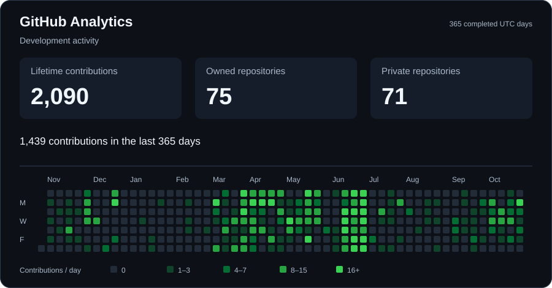

# Albert Cortel

**Senior Full-Stack .NET Engineer**

Architecting enterprise platforms end-to-end — from Angular SPAs and WPF desktop clients to ASP.NET Core APIs, SQL Server, and self-managed Linux infrastructure.

---

### About

Self-taught full-stack engineer with 5+ years of hands-on experience across the entire delivery lifecycle — architecture, implementation, deployment, and infrastructure. I build production systems that run at enterprise scale and maintain the servers they run on.

My work spans **ASP.NET Core** REST APIs with **Clean Architecture**, **Angular** frontends, **WPF** desktop applications, **SQL Server** databases, and **Linux** server infrastructure — all the way down to hardware-level protocol work and reverse engineering. I don't treat systems as black boxes; I understand them at the lowest implementation level.

Currently a Full-Stack Engineer at **AXA Philippines** — one of the country's largest insurers serving 1.5M+ customers — building and maintaining enterprise-grade digital platforms. On the side, I'm building **iMiraiHub**, a multi-tenant HRIS/Payroll SaaS for the Philippine market.

---

### Tech Stack

**Backend & API**

`ASP.NET Core` `ASP.NET MVC` `Clean Architecture` `Entity Framework Core` `Dapper` `SignalR` `JWT Auth` `MSSQL` `Redis` `MariaDB` `MongoDB`

**Frontend & Desktop**

`Angular` `WPF (Fluent UI / MVVM)` `WinForms` `Blazor WASM` `FlutterFlow`

**Infrastructure & DevOps**

`Ubuntu Server` `NGINX Reverse Proxy` `Docker` `Coolify (Self-hosted PaaS)` `Wildcard DNS/SSL` `MinIO` `Pi-hole` `VPS Management`

**Self-Hosted Services**

`Ollama (LLM)` `Flowise AI` `CloudBeaver` `Firefly III` `Bigcapital` `GitLab`

---

### Shipped Products

<table>
<tr>
<td width="50%">

#### 📱 TimeExacto — Mobile HRIS

[Website](https://timeexacto.com/) · [iOS](https://apps.apple.com/app/timeexacto/id6738023550) · [Android](https://play.google.com/store/apps/details?id=com.jjglobal.timehub)

Mobile-first workforce management built at JJ Global Services. FlutterFlow + ASP.NET Core backend. Live GPS tracking, biometric auth, smart scheduling, payroll integration, multi-location support.

</td>
<td width="50%">

#### 🏢 TimeHub — Enterprise Platform

[Website](https://jjglobaltimehub.com/)

Full-stack web platform built at JJ Global Services. Blazor WASM frontend, C# backend. Real-time analytics, automated reporting, compliance management. **99.9% uptime**, 500+ active employees.

</td>
</tr>
</table>

---

### What I'm Building

<table>
<tr>
<td width="50%" valign="top">

#### 🚀 iMiraiHub

**Multi-tenant HRIS & Payroll SaaS** for the Philippine market.

- ASP.NET Core API — Clean Architecture
- Dual-client auth: Angular (cookie) + WPF (JWT)
- Self-hosted on Ubuntu VPS via Coolify
- MinIO object storage, Flowise AI chatbot with Ollama, Bigcapital accounting
- Wildcard SSL, NGINX, Pi-hole DNS filtering

</td>
<td width="50%" valign="top">

#### 🔧 PinoyTechClient

**C# WPF desktop application** — .NET backend with JWT authentication and Clean Architecture.

- Fluent UI with Mica backdrop, custom Geist fonts
- MVVM architecture with NavigationView
- SQL Server backend with repository pattern
- Custom DataGrid, CardExpander components
- Custom title bar with multi-monitor drag support

</td>
</tr>
</table>

---

### Low-Level & Research

Beyond full-stack development, I reverse engineer hardware protocols and build tooling at the firmware level:

- **MediaTek XFlash V5** — Implemented DA protocol from scratch: write framing (3 packets/chunk), chunked reads for 64KB DA cap, erase commands
- **XFlash V6 Research** — XML-based protocol for Dimensity chipsets, preloader mode, Carbonara exploit analysis
- **IMEI Read/Write** — MT65xx/MT67xx support via NvramCrypto
- **Preloader Scanner** — Device matching system with confidence scoring
- **Qualcomm RE** — Independently reverse engineered Qualcomm flashing tool without external assistance

---

<!-- combined-profile-stats:start -->
### GitHub Analytics

Contribution history across **[iMirai007](https://github.com/iMirai007)** and **[Artimatrix007](https://github.com/Artimatrix007)**, including private activity. Lifetime contributions, owned/private repository counts, and a combined contribution calendar refresh from GitHub. Repository names and source code remain private.

The first authenticated refresh is pending. [View metric definitions and setup](PROFILE_STATS.md).
<!-- combined-profile-stats:end -->

---

<b>Development Environment</b>

 

| Category | Tools |
|---|---|
| **Workspace** | Visual Studio 2026, Git, GitHub |
| **Application stack** | C#, ASP.NET Core / MVC, Blazor WebAssembly, .NET MAUI, Angular, Windows Forms |
| **Web tooling** | JavaScript, Node.js, npm, Yarn, Sass, Bootstrap 5.3 |
| **Data** | Microsoft SQL Server, Redis, Entity Framework Core |
| **Infrastructure & delivery** | Ubuntu Server, NGINX, Coolify, Azure, AWS, Red Hat OpenShift, CI/CD |
| **Debugging & analysis** | dnSpy, HTTP Debugger, legacy system analysis, performance tuning |
| **Reporting** | DevExpress Reports, EPPlus |

Stack and tooling listed on [albertcortel.com](https://albertcortel.com/).

---

📧 **imiraidev007@gmail.com** · 🌐 [**albertcortel.com**](https://albertcortel.com/)

